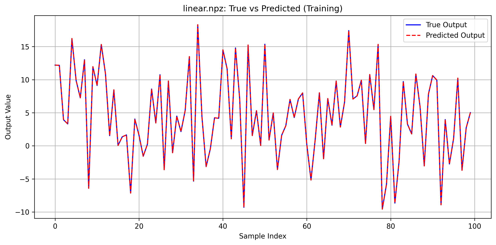
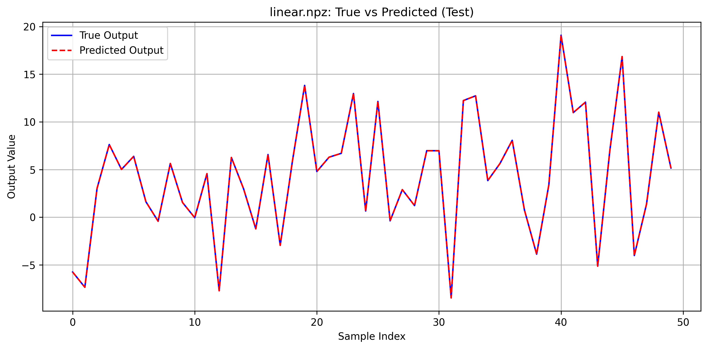
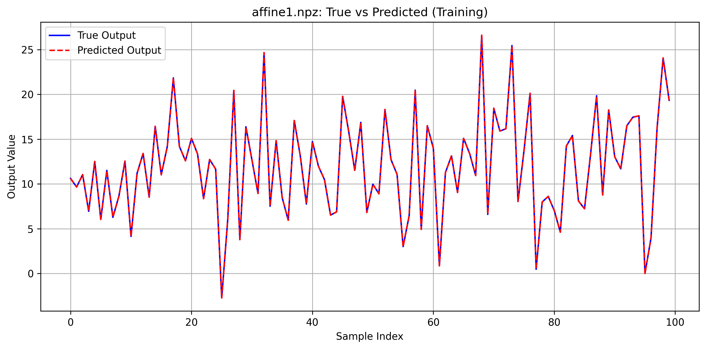
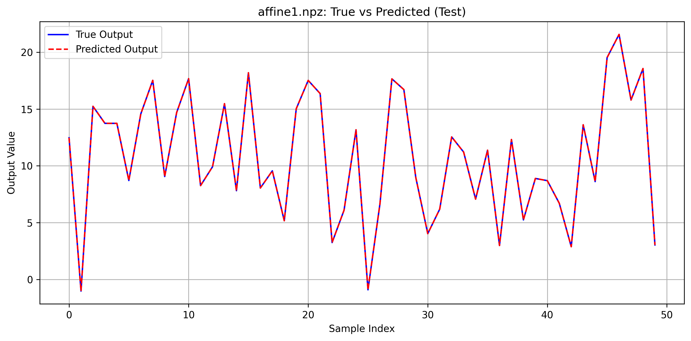
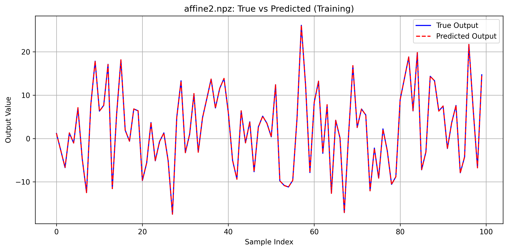
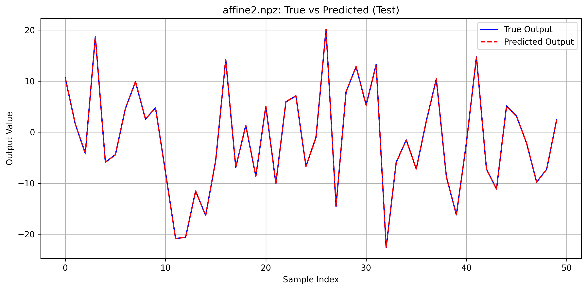
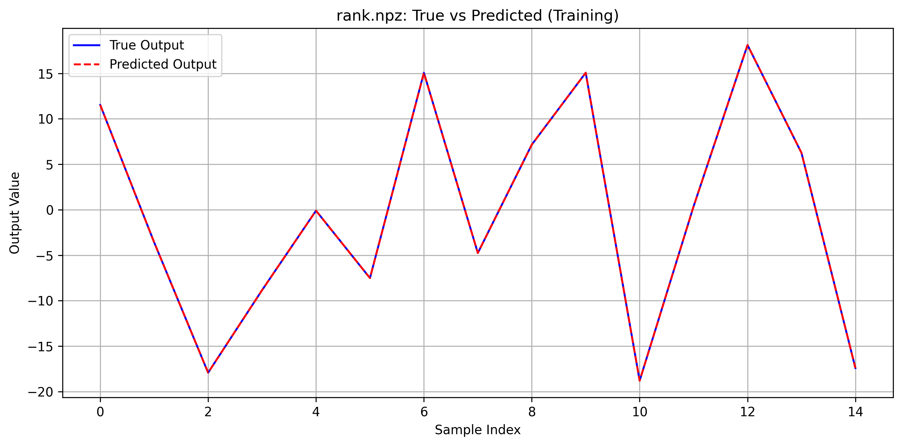
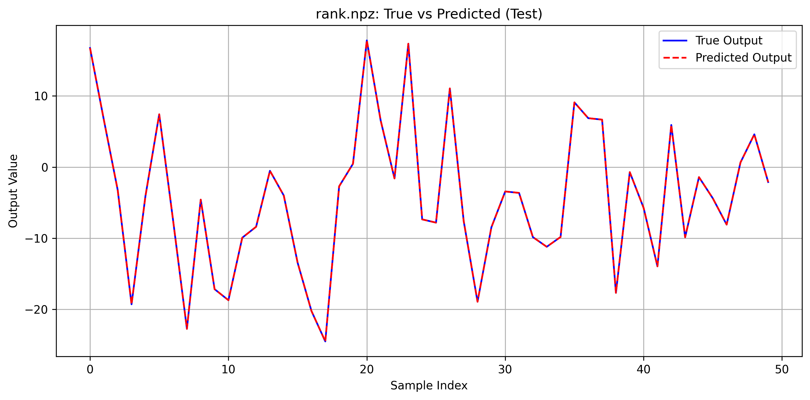
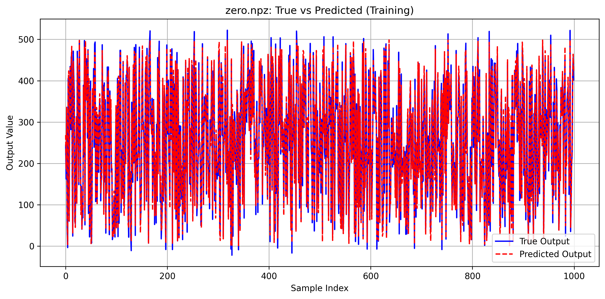
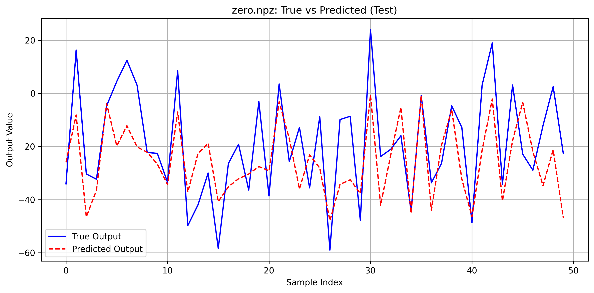

# Linear Regression from Scratch

A Python project implementing linear regression using NumPy, with experiments on five datasets and visualizations using Matplotlib.

The project includes an interactive terminal analyzer for selecting datasets, evaluating model performance, and visualizing training and test predictions.

## Features

- Implement linear regression using the Normal Equation, with or without a bias term.
- Evaluate model performance using training and test Mean Squared Error (MSE).
- Select individual datasets or run all experiments through an interactive terminal menu.
- Generate separate training and test graphs comparing actual and predicted outputs, with optional PNG exports.
- Analyze the effects of weight perturbations on model accuracy.
- Handle rank-deficient datasets using the pseudoinverse and NumPy's least-squares solver.
- Examine near-zero weights to identify potentially irrelevant features.

## Project Structure

```text
linear-regression-from-scratch/
├── src/
│   ├── linear_regression.py
│   └── plots/                # Saved graphs (generated automatically)
├── data/
│   ├── linear.npz
│   ├── affine1.npz
│   ├── affine2.npz
│   ├── rank.npz
│   └── zero.npz
├── README.md
├── requirements.txt
└── .gitignore
```

## Getting Started

**1. Install dependencies**

From the repository's root folder:

```bash
python3 -m pip install -r requirements.txt
```

**2. Run the analyzer**

```bash
python3 src/linear_regression.py
```

**3. Select an output option**

```text
=== Choose Output Type ===
1. Show training output only
2. Show test output only
3. Show both training and test outputs
4. Run all datasets (training only)
5. Run all datasets (test only)
6. Run all datasets (both training and test)
0. Exit
```

For individual experiments, select one of the five datasets. The program displays model weights, training and test MSE, and the selected graphs. Graphs can optionally be saved to `src/plots/`.

## Datasets

| Dataset | Description |
|---|---|
| `linear.npz` | Linear regression without a bias term |
| `affine1.npz` | Linear regression with a bias term |
| `affine2.npz` | Analysis of weight perturbations |
| `rank.npz` | Rank-deficient data and pseudoinverse solutions |
| `zero.npz` | Analysis of near-zero feature weights |

Each dataset contains training and test inputs and outputs.

## Sample Results

Training and test predictions for all five datasets are displayed side by side. Each graph compares actual outputs with the model's predictions.

| Dataset | Training Predictions | Test Predictions |
|---|---|---|
| **Linear Regression** (`linear.npz`) |  |  |
| **Affine Regression** (`affine1.npz`) |  |  |
| **Weight Perturbation** (`affine2.npz`) |  |  |
| **Rank-Deficient Regression** (`rank.npz`) |  |  |
| **Near-Zero Feature Weights** (`zero.npz`) |  |  |

*Note: The plots show predictions made using the fitted model. Perturbed-weight results and rank-deficiency diagnostics are reported in the terminal, not directly depicted by these plots.*

## Technologies

Python · NumPy · Matplotlib

## Learning Objectives

Explore linear regression, matrix operations, model evaluation, numerical stability, and the effects of model parameters through practical experiments.
